

# Parabellum

**El launcher de Minecraft para jugar con tus amigos.** Mods, modpacks, servidores propios y chat en una sola ventana, sin cuenta premium.

   

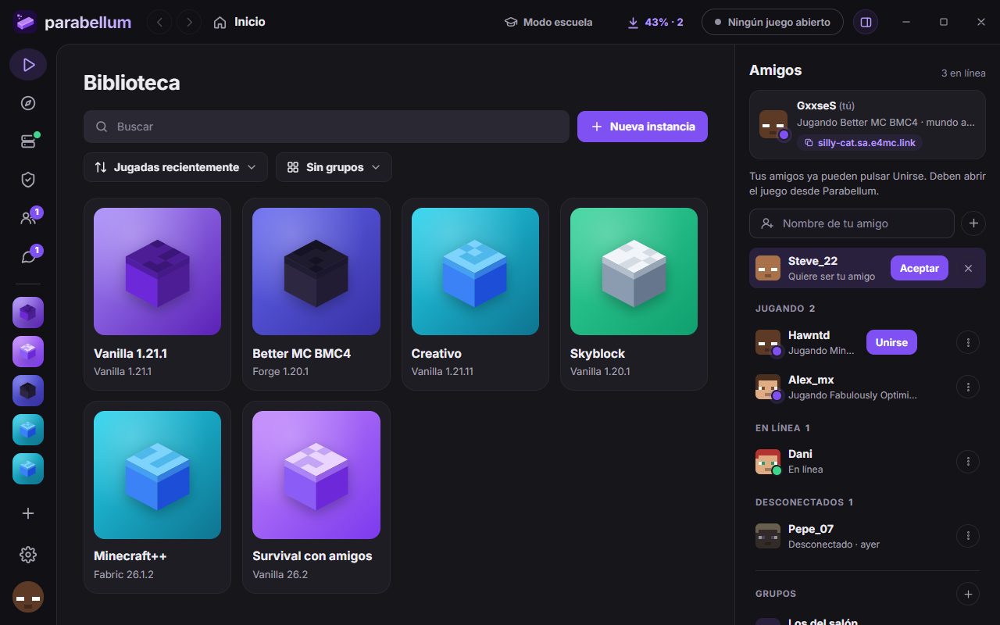

## Qué puedes hacer

<table>
  <tr>
    <td width="50%" valign="top"><b>🎮 Jugar sin complicarte</b> Creas una instancia (Vanilla, Fabric, Quilt, Forge o NeoForge), pulsas <b>Jugar</b> y Parabellum baja lo que falte, también el Java correcto. Entras con tu nombre de jugador.</td>
    <td width="50%" valign="top"><b>🧩 Mods y modpacks de Modrinth</b> Busca mods, resource packs, shaders, data packs y modpacks, y ve solo lo que sirve para tu instancia. Instala con sus dependencias y actualiza todo con un clic.</td>
  </tr>
  <tr>
    <td width="50%" valign="top"><b>🩺 El doctor</b> Si el juego se cierra, te dice por qué en palabras normales y lo arregla con un botón: el mod que choca, el loader que falta o la memoria que no alcanza. También puede <b>buscar el mod culpable</b> solo.</td>
    <td width="50%" valign="top"><b>🌐 Hostear partida</b> Convierte una instancia en un servidor en tu PC y tus amigos entran con <b>Unirse</b>, sin abrir puertos ni pasar IPs. Los ajustes del servidor se cambian como en Aternos, sin comandos.</td>
  </tr>
  <tr>
    <td width="50%" valign="top"><b>💬 Amigos y mensajes</b> Ve a qué juega cada quien y únete a su partida. Chat y grupos con imágenes, respuestas y reacciones.</td>
    <td width="50%" valign="top"><b>🕹️ Dentro del juego</b> Con la tecla <b>O</b> se abre Parabellum dentro de Minecraft: amigos, mensajes, invitaciones y capturas, sin salir del mundo (Fabric, Forge y NeoForge, de la 1.16.5 a la 26.3).</td>
  </tr>
  <tr>
    <td width="50%" valign="top"><b>🛡️ Comunidades</b> Únete con un código a la comunidad de un servidor. <b>Jugar</b> instala el paquete oficial de mods y te deja dentro del servidor. Si cambiaste mods, te avisa y lo deja como el oficial con un clic.</td>
    <td width="50%" valign="top"><b>🏫 Modo escuela</b> En redes que bloquean Minecraft o Modrinth, Parabellum baja todo de Google Drive: versiones, loaders, Java y mods.</td>
  </tr>
  <tr>
    <td width="50%" valign="top"><b>⬇️ Descargas</b> Cola de descargas con avance, cancelar, reintentar y límite de velocidad. Si algo falla, al reintentar sigue donde quedó.</td>
    <td width="50%" valign="top"><b>🔄 Se actualiza solo</b> Al abrirlo busca la versión nueva y se actualiza. Si una actualización no arranca, vuelve sola a la anterior.</td>
  </tr>
  <tr>
    <td width="50%" valign="top"><b>🛟 Soporte de tu comunidad</b> ¿Algo no funciona? <b>Pide ayuda</b> y el equipo de soporte ve tu problema con el diagnóstico de tu instancia. Te pueden mandar un ajuste que aplicas con un clic (y deshaces igual).</td>
    <td width="50%" valign="top"><b>🗂️ Copias de seguridad</b> Antes de actualizar o restaurar un modpack, Parabellum guarda lo que cambia. Si algo sale mal, lo recuperas desde los detalles de la instancia.</td>
  </tr>
</table>

Funciona en **español e inglés**, con tema **oscuro y claro**, y se puede usar entero con el teclado.

## Capturas

<table>
  <tr>
    <td width="50%">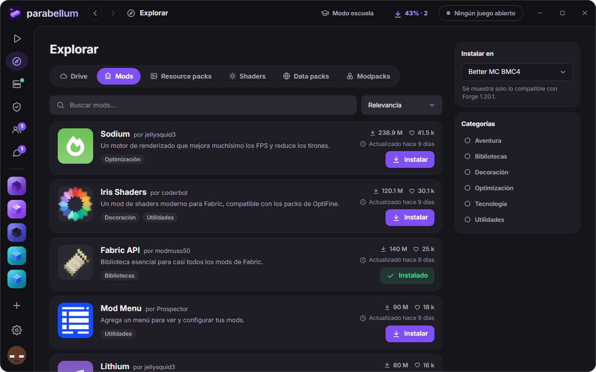 <b>Explorar</b>: mods de Modrinth compatibles con tu instancia.</td>
    <td width="50%">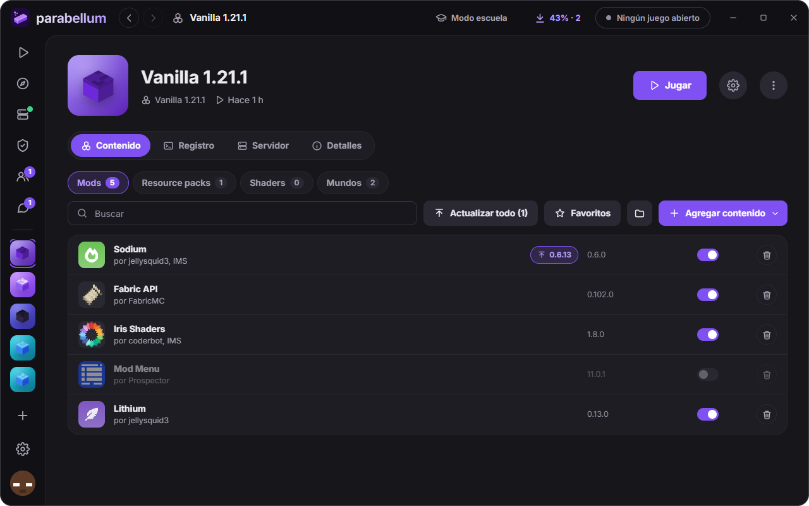 <b>Instancia</b>: sus mods, packs, shaders y mundos.</td>
  </tr>
  <tr>
    <td>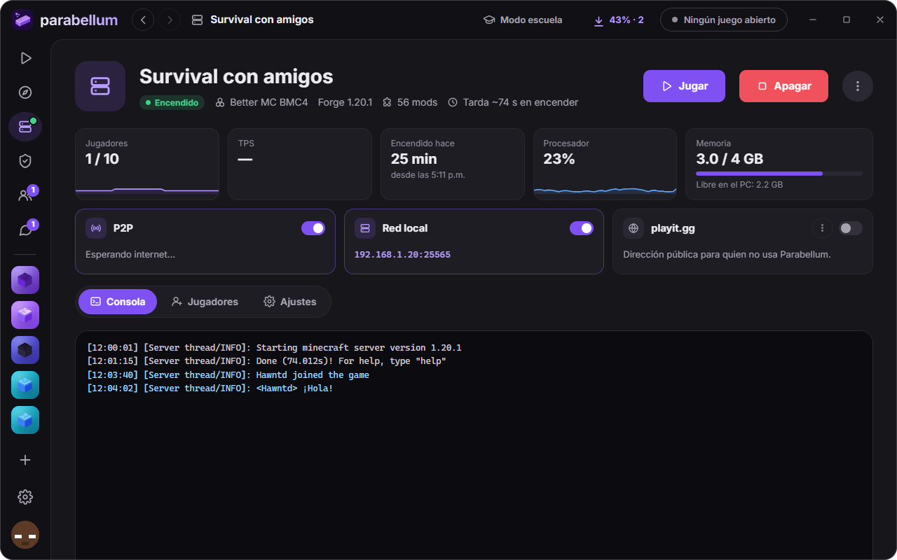 <b>Hostear partida</b>: tu servidor, con P2P, red local y consola.</td>
    <td>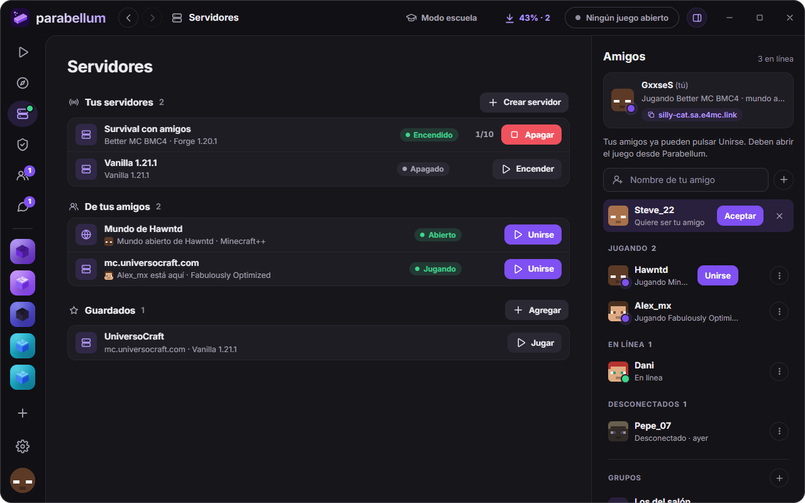 <b>Servidores</b>: los tuyos, los de tus amigos y los guardados.</td>
  </tr>
  <tr>
    <td>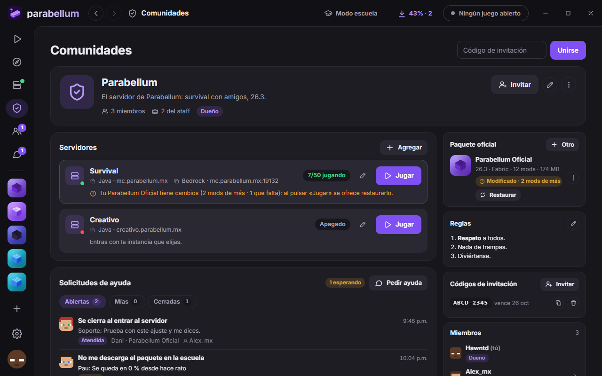 <b>Comunidades</b>: servidores, paquete oficial y las solicitudes de ayuda.</td>
    <td>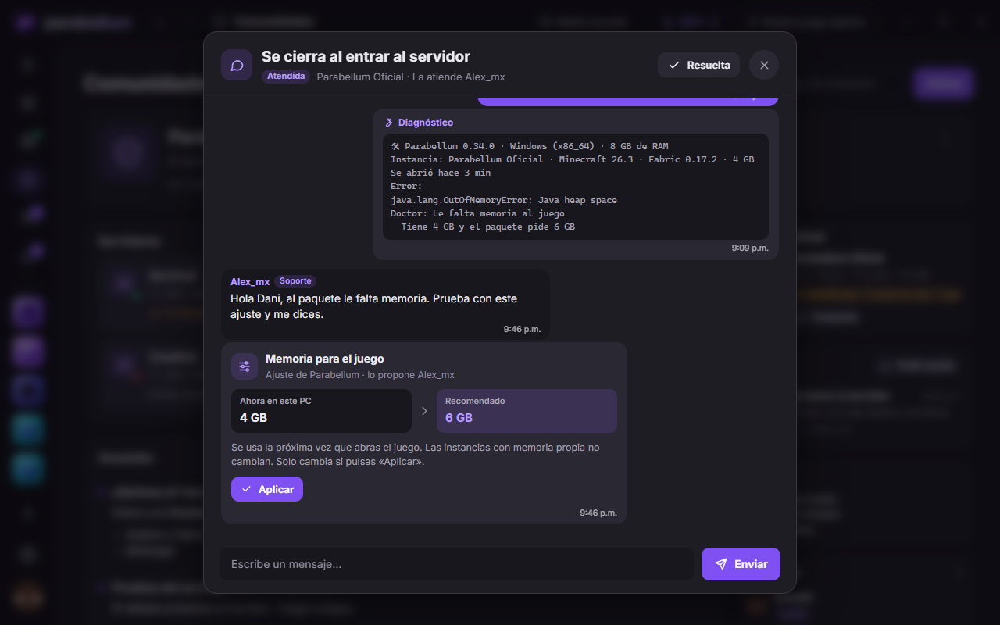 <b>Soporte</b>: tu diagnóstico y el ajuste que te proponen.</td>
  </tr>
  <tr>
    <td>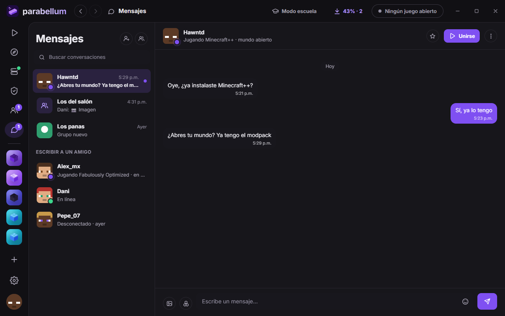 <b>Mensajes</b>: chat con amigos y grupos.</td>
    <td>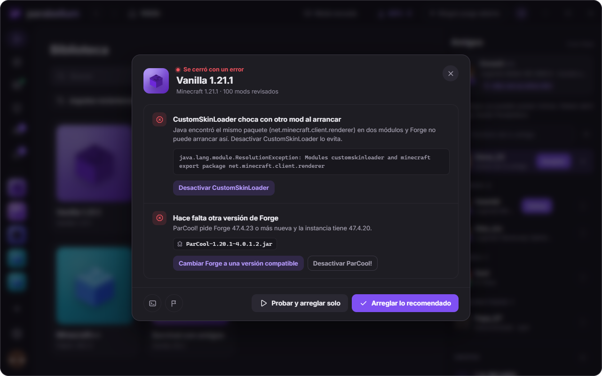 <b>El doctor</b>: por qué se cerró el juego y cómo arreglarlo.</td>
  </tr>
  <tr>
    <td>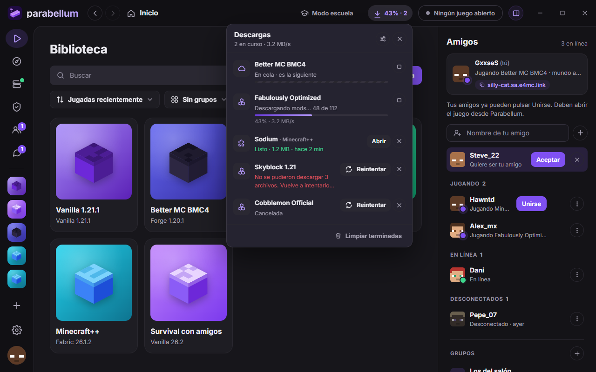 <b>Descargas</b>: la cola, el avance y la velocidad.</td>
    <td>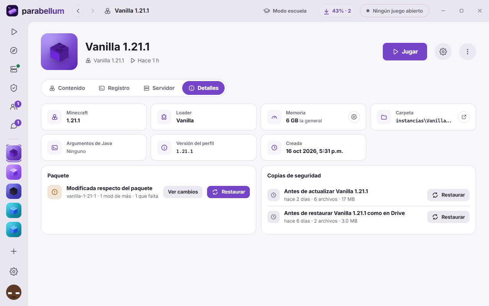 <b>Tema claro</b>: los detalles de una instancia, con sus copias de seguridad.</td>
  </tr>
</table>

## Descargar e instalar

1. Baja **[Parabellum-0.34.0.zip](https://github.com/juanrojasgarcialin/parabellum-rs/releases/download/v0.34.0/Parabellum-0.34.0.zip)** (10 MB).
2. Descomprímelo en una carpeta tuya, por ejemplo `Escritorio\Parabellum` o una USB. Parabellum no se instala: todo lo suyo (instancias, mundos y ajustes) se queda en esa carpeta.
3. Abre **`Parabellum.exe`**. La primera vez Windows puede mostrar «Windows protegió tu PC»: pulsa **Más información** › **Ejecutar de todas formas**. Las actualizaciones ya no muestran ese aviso.
4. Escribe tu nombre de jugador, crea una instancia y pulsa **Jugar**.

**Necesitas** Windows 10 u 11 de 64 bits. No hace falta instalar Java ni nada más.

**¿Tienes Mac?** Hay versión para Mac con chip Apple (macOS 13 o más nuevo). Se reparte aparte: pídesela a quien te compartió Parabellum.

## Versiones

Parabellum **se actualiza solo**: al abrir una versión vieja, baja la más nueva. Las anteriores quedan aquí como historial.

| Versión | Fecha | Lo nuevo | Descarga |
|---|---|---|---|
| [**0.34.0**](https://github.com/juanrojasgarcialin/parabellum-rs/releases/tag/v0.34.0) la&nbsp;más&nbsp;nueva | 20&nbsp;oct&nbsp;2026 | **Soporte en las comunidades**: pide ayuda con el diagnóstico de tu instancia (sin tu carpeta de usuario, correos ni claves) y el equipo de soporte te contesta. Te pueden mandar **tarjetas de ajustes** que aplicas con un clic y deshaces igual. | [⬇&nbsp;Descargar](https://github.com/juanrojasgarcialin/parabellum-rs/releases/download/v0.34.0/Parabellum-0.34.0.zip) |
| [**0.33.0**](https://github.com/juanrojasgarcialin/parabellum-rs/releases/tag/v0.33.0) | 20&nbsp;oct&nbsp;2026 | El paquete oficial de una comunidad avisa si le cambiaste mods, te muestra qué cambió y lo deja como el oficial con **Restaurar**. Antes de actualizar o restaurar se guarda una **copia de seguridad** que recuperas en Detalles de la instancia. | [⬇&nbsp;Descargar](https://github.com/juanrojasgarcialin/parabellum-rs/releases/download/v0.33.0/Parabellum-0.33.0.zip) |
| [**0.32.0**](https://github.com/juanrojasgarcialin/parabellum-rs/releases/tag/v0.32.0) | 20&nbsp;oct&nbsp;2026 | Mods de Modrinth en redes que bloquean Modrinth, sin modo escuela. Interfaz pulida de punta a punta: campos más claros, gráficas del servidor, animaciones al cargar y al cambiar de tema. | [⬇&nbsp;Descargar](https://github.com/juanrojasgarcialin/parabellum-rs/releases/download/v0.32.0/Parabellum-0.32.0.zip) |
| [**0.31.2**](https://github.com/juanrojasgarcialin/parabellum-rs/releases/tag/v0.31.2) | 18&nbsp;oct&nbsp;2026 | Si Drive no entrega un paquete a la primera, se reintenta (antes, a veces no aparecía). | [⬇&nbsp;Descargar](https://github.com/juanrojasgarcialin/parabellum-rs/releases/download/v0.31.2/Parabellum-0.31.2.zip) |
| [**0.31.1**](https://github.com/juanrojasgarcialin/parabellum-rs/releases/tag/v0.31.1) | 18&nbsp;oct&nbsp;2026 | **Comunidades**: códigos de invitación, anuncios, reglas, servidores y el paquete oficial que se instala al pulsar Jugar. Canal de pruebas en Ajustes › Acerca de. | [⬇&nbsp;Descargar](https://github.com/juanrojasgarcialin/parabellum-rs/releases/download/v0.31.1/Parabellum-0.31.1.zip) |
| [**0.30.0**](https://github.com/juanrojasgarcialin/parabellum-rs/releases/tag/v0.30.0) | 18&nbsp;oct&nbsp;2026 | Todo Minecraft desde Google Drive y el botón **Modo escuela**. Gestor de descargas, pantalla de carga, chat más completo (imágenes pegadas, emojis, buscar), «Buscar el mod culpable» y las actualizaciones que no arrancan se deshacen solas. | [⬇&nbsp;Descargar](https://github.com/juanrojasgarcialin/parabellum-rs/releases/download/v0.30.0/Parabellum-0.30.0.zip) |
| [**0.28.0**](https://github.com/juanrojasgarcialin/parabellum-rs/releases/tag/v0.28.0) | 13&nbsp;oct&nbsp;2026 | Página de Amigos, mensajes con respuestas y reacciones, grupos con foto, «Reportar problema», Servidores y Hostear en una sola página, y el panel del juego igual que la ventana. | [⬇&nbsp;Descargar](https://github.com/juanrojasgarcialin/parabellum-rs/releases/download/v0.28.0/Parabellum-0.28.0.zip) |
| [**0.25.0**](https://github.com/juanrojasgarcialin/parabellum-rs/releases/tag/v0.25.0) | 12&nbsp;oct&nbsp;2026 | Animaciones en toda la ventana. Dentro del juego: panel animado, botón «Parabellum» en el menú de pausa y avisos abajo a la derecha. | [⬇&nbsp;Descargar](https://github.com/juanrojasgarcialin/parabellum-rs/releases/download/v0.25.0/Parabellum-0.25.0.zip) |
| [**0.24.1**](https://github.com/juanrojasgarcialin/parabellum-rs/releases/tag/v0.24.1) | 12&nbsp;oct&nbsp;2026 | El mod del juego gasta lo mínimo y se aparta solo si hace caer el juego. | [⬇&nbsp;Descargar](https://github.com/juanrojasgarcialin/parabellum-rs/releases/download/v0.24.1/Parabellum-0.24.1.zip) |

Todas las versiones, con sus notas completas: [Releases](https://github.com/juanrojasgarcialin/parabellum-rs/releases).

## Preguntas frecuentes

<b>Windows dice que «protegió tu PC». ¿Es seguro?</b>

Sale porque `Parabellum.exe` no tiene una firma de pago, no porque haya algo malo. Pulsa **Más información** › **Ejecutar de todas formas**. Pasa solo la primera vez: las actualizaciones las baja Parabellum mismo.

<b>¿Dónde quedan mis mundos y mis mods?</b>

En la carpeta donde descomprimiste Parabellum: cada instancia está en `instancias\<nombre>`, con sus mundos en `saves`. Puedes copiar la carpeta entera a una USB y seguir en otra PC.

<b>En mi escuela no carga Minecraft o Modrinth.</b>

Pulsa **Modo escuela** arriba en la ventana: Parabellum baja Minecraft, los loaders y Java de Google Drive. Los mods de Modrinth funcionan aunque la red los bloquee, sin hacer nada.

<b>¿Cómo juego con mis amigos?</b>

Agréguense en **Amigos** (con su cuenta de Google). Después, uno crea un servidor en **Servidores** › **Crear servidor** o abre su mundo en LAN, y a los demás les aparece con **Unirse**. No hay que abrir puertos ni pasar IPs.

<b>El juego se cierra al abrir. ¿Qué hago?</b>

Parabellum abre **el doctor** solo: te dice qué pasó y te ofrece el arreglo. Si no se resuelve, en tu comunidad pulsa **Pedir ayuda**: el equipo de soporte ve tu problema con el diagnóstico de la instancia. Si no estás en una comunidad, usa **Reportar problema** (en el menú ⋮ de la instancia) y manda el resumen por chat a quien te ayuda.

<b>¿Cómo lo actualizo?</b>

No tienes que hacer nada: al abrirlo busca la versión nueva, la baja y se reinicia. Los juegos abiertos siguen; si tienes un servidor encendido, espera a que lo apagues.

---

¿Quieres compilarlo o colaborar? Está en <a href="docs/desarrollo.md">docs/desarrollo.md</a>.

Fuente <a href="https://github.com/rsms/inter">Inter</a> bajo la SIL Open Font License. Parabellum no es un producto oficial de Minecraft: no está aprobado por Mojang ni por Microsoft, ni asociado con ellos.

